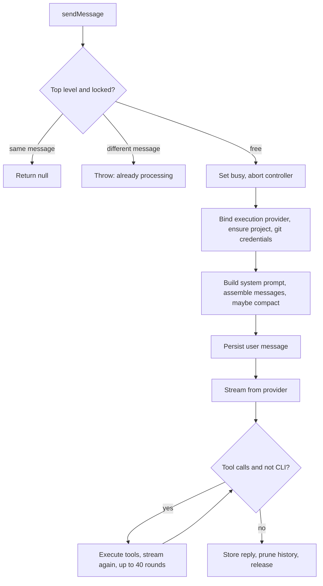

# Agent lifecycle and chat

`AgentManager` (`api/src/services/agentManager/`) is the central service of the API. It owns live agent state and runs conversations. The class is a thin shell in `index.ts`, with behaviour assembled from mixin modules, so look in the module rather than the class:

| Module | Responsibility |
|---|---|
| `crud.ts`, `getters.ts`, `lifecycle.ts` | Create, update, delete and read agents |
| `chat.ts` | `sendMessage`, prompt building, streaming and retries |
| `compaction.ts` | Context thresholds, token estimates, history compaction |
| `tools.ts` | Native tool execution and task completion recording |
| `status.ts` | Status changes, stopping agents, stream tracking |
| `conversation.ts` | Clear history, reload context, restart runtime, switch project |
| `broadcast.ts` | Fan-out messages and handoff |
| `tasks.ts`, `workflow.ts` | Task loop and workflow integration; see [Tasks and workflow engine](../tasks/workflow-engine.md) |

## State

Agents live in the `this.agents` map and are loaded from PostgreSQL at startup. Fields such as `status`, `currentTask` and `currentThinking` are reset on load, so an agent always comes back idle after a restart. Tasks are deliberately **not** cached in memory: the database is the single source of truth for them. Other transient state, including abort controllers, chat locks and active streams, is held in maps on the instance and is lost on restart.

Stale `action_running` flags are not cleared at startup, but on the first task loop tick, when the current environment is known. Doing it earlier could clear the locks of a sibling deployment sharing the database.

## Two ways an agent runs

An agent's `runner` decides how its turn executes. `isCliRunner` in `api/src/services/runners.ts` is the single source of truth:

| Kind | Runners | Who runs the model and tools |
|---|---|---|
| CLI runner | `claudecode` (alias `coder`), `codex`, `opencode`, `openclaw`, `hermes`, `aider`, `vibe` | A CLI in the [runner service](../runners/runner-service.md), which runs its own tool loop |
| Native | `sandbox`, the in-house runtime | The API calls the LLM directly and executes tools through the execution layer |

Most of `sendMessage`'s branching comes from this split. CLI runners also get a different prompt: `buildRunnerInstructions` has no text-tool syntax. Shared sections live in `promptSections.ts`, and that file warns that some differences between the two are deliberate.

## A chat turn

Details that matter when changing this:

- **Chat lock.** A top-level message takes a per-agent lock. A duplicate of the locked message returns `null` and a different one throws, unless the agent is no longer busy, in which case the stale lock is cleared.
- **`ensureProject` runs on every chat.** A restarted runner loses its in-memory project mapping and would fall back to `/app`. A 60-second TTL in the provider keeps this cheap.
- **Git credentials are shipped even with no project**, because the agent may clone something on its own initiative.
- **Early persistence.** The user message is saved before the LLM call, so a crash during a long stream does not lose it. Only top-level and delegation messages get this synchronous write.

### Limits and retries

| Limit | Value | Behaviour |
|---|---|---|
| Native tool rounds | 40 | The model is warned 5 rounds before; at the limit a final summary is requested. Even a failed summary does not discard the work |
| Truncation continuations | 3 | Continues when `finishReason` is `length` |
| Stream retries | 3 | On transient connection errors, unless aborted |
| Tool images per round | 4 | Further images are dropped |
| Stored history | 30 entries | Messages of the active task are preserved past this limit |

Provider rate limit messages are detected in the response. The turn then fails with `isRateLimit` and a `retryAt` time, and the message is removed from history.

## System prompt

`_buildSystemPrompt` assembles the agent's name and role, instructions, plugin instructions, RAG documents, MCP tools and tasks. Two rules shape it:

- **Tenant bounds.** Everything the prompt names about the rest of the instance, including sibling agents, boards and repos, is limited by the agent's own board scope (`lib/agentScope.ts`). Leaking other tenants' agent names here would be a cross-tenant disclosure.
- **Only the 3 most relevant tasks.** Tasks are ranked by a mix of semantic similarity and recency, then truncated. Without this bound, agents with many tasks sent over 100 KB on each turn, adding minutes of latency before the first token.

Only leader agents at delegation depth 0 receive the agent roster. Task text passes through `lib/taskTrust.ts` when rendered, since it may come from untrusted sources. See [Agent isolation and secrets](../security/agent-isolation.md).

## Compaction

`_compactionThresholds` scales with the model's context size:

| Context limit | Keep recent | Trigger | Reset | Safety ratio |
|---|---|---|---|---|
| 200,000+ | 80 | 110 | 90 | 0.80 |
| 128,000+ | 40 | 55 | 45 | 0.80 |
| 32,000+ | 16 | 24 | 20 | 0.75 |
| Smaller | 10 | 15 | 12 | 0.75 |

Three mechanisms apply:

1. **Proactive:** `_assembleMessages` compacts above the trigger, then disarms until the count falls below the reset, which prevents compaction loops.
2. **Emergency:** compacts just before the request if the estimate is too large for the window.
3. **Reactive:** after a context error from the provider, compacts harder and retries once (`_compactionRetried`).

Token counts are estimates at about 3 characters per token. `_classifyLlmRequestError` also treats a bare provider 400 near the window as a context error, as some providers give no explanation.

## Status and stopping

`setStatus` moves an agent between `idle`, `busy` and `error`, writes an action log and emits `agent:status` over WebSocket. `stopAgent` aborts the turn and halts tasks, and for a leader it also stops busy agents in its team. For CLI agents, `requestCliTerminalInterrupt` also interrupts the terminal session, since aborting the HTTP call alone would leave the CLI running.

## Delegation and broadcast

- **Broadcast** (`broadcastMessage`) sends one message to all enabled agents in parallel, tagging each stream chunk with its agent ID. A failure on one agent is recorded in the results and does not stop the rest.
- **Handoff** (`handoff`) passes a message and context to another agent, transferring user files.
- **Delegation** now goes through tools: the system prompt points leaders to the Swarm API MCP tools, and the management surface has `delegate_task`.

**The README is out of date on this point.** It documents an `@delegate(AgentName, "task")` text syntax, which no longer appears in `api/src`.
