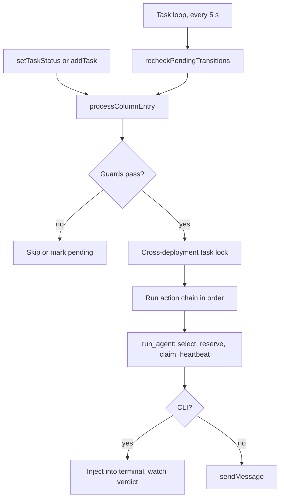

# Tasks and workflow engine

A board's workflow makes it an automation: when a task enters a column, configured actions run, usually sending it to an agent. Functional behaviour is in `specs/ui/workflows.md` and `specs/api/tasks.md`. The code is in `api/src/services/workflow/`, with the task loop in `agentManager/tasks.ts`.

| Module | Responsibility |
|---|---|
| `taskStateMachine.ts` | Pure logic: triggers, action types, matching transitions. No I/O |
| `workflowEngine.ts` | Orchestration: column entry, retries, recovery |
| `actionExecutor.ts` | Performs each action |
| `agentSelector.ts` | Finds and reserves an agent |
| `runClaims.ts` | Durable claims |
| `decisionAction.ts`, `../decisionModel.ts` | Routing with a decision model |
| `roleRouter.ts` | Automatic role choice |

## Workflow configuration

Stored per board, a workflow has `columns` and `transitions`. Each transition has a source column, a trigger, conditions, and a chain of actions. The default is in `services/boardDefaults.ts`: `in_progress` runs an agent with an automatically chosen role.

| Trigger | When |
|---|---|
| `on_enter` | A task enters the column |
| `condition` | Evaluated periodically for tasks in the column |

| Action | Effect |
|---|---|
| `run_agent` | Runs an agent in a mode: `refine`, `decide`, `title` or `set_type` |
| `change_status` | Moves the task |
| `assign_agent`, `assign_agent_individual` | Sets the assignee |
| `decision_model` | Routes to a column using a typed decision model |

`done`, `backlog` and `error` are inactive statuses. A role of `__auto__` asks the admin-configured Role Router LLM to pick among roles staffed on the board. **Any failure there puts the task in error**, rather than choosing arbitrarily or repeatedly calling the LLM. The board is a fence: only agents on it are eligible.

## How a task runs

`processColumnEntry` reads the **current row**, since a user may have just stopped the task, then skips if:

- The task is in `error`, or has moved to another column.
- It's manual (`isManual`).
- It's external and awaiting human approval. No action runs, not even an assignment.
- `executionStatus` is `stopped`, so that a Stop isn't undone seconds later.
- It belongs to another environment. It is left armed for that deployment.

**Deferred entries.** If a task is already processing, a nested entry doesn't run but writes a durable `pending_on_enter` marker. The parent's chain, or the recheck after a restart, handles it later.

**Persistence rule.** The engine never saves a whole task row. Its bookkeeping uses targeted updates **guarded by the column the chain runs in**, so a late write can't corrupt the task after it has moved on.

### CLI runs

A CLI task is injected into the [shared terminal](../runners/runner-service.md#delivering-a-task-to-a-tui), then the engine waits for a verdict, with several signals:

- `claudecode` signals through `update_task`. Other CLIs are `SELF_COMPLETING_RUNNERS`, and completion is detected on their behalf.
- `_probeCliAuth` catches authentication failures, which otherwise look like success.
- A reminder loop nudges a quiet agent, holding off while it's busy.
- `_drainCliRun` waits for the CLI to finish before moving on.

### Commit linking

`agentManager/tools/gitReconcile.ts` links commits to tasks using a baseline HEAD recorded for each run, including secondary repos. **Repository history alone isn't enough**, since pulls bring in unrelated commits, sometimes from the same identity. With no run context, nothing is auto-linked.

## One run per agent

**Invariant: an agent never works two tasks at once.** A CLI can report idle while its task is still running, so status isn't enough. Three layers enforce this:

| Layer | Scope | Mechanism |
|---|---|---|
| Reservation | This process | `reserveAgentForTask`: synchronous and exclusive by agent **and** task. Live runs never expire from elapsed time |
| Claim | All processes | `claimRun`: sets `action_running` with a guard, and the unique index `uniq_tasks_running_agent` backstops races. A heartbeat runs every 20 s |
| Task lock | All processes | [Advisory lock](../data/persistence-and-migrations.md#cross-deployment-task-locks), for the processing chain |

`refreshClaimedAgents` reloads the set of claimed agents just before selection. The snapshot can lag, which the unique index covers. `docs/workflow-concurrency-2026-09-11.md`, in French, records the incident behind the shared reservation: manual resume and the workflow each reserved separately and both picked the same agent.

Automatic assignment filters out busy and reserved agents before preferring board or project matches.

## Decision models

A `decision_model` action routes a task to a column with a typed classifier, such as the AIFabric `/v1/systemone` service, without running an agent:

- The config's endpoint is admin-owned, checked by `assertAdminServiceUrl`. Decision models can't be used as chat models.
- It sends title, description, type and priority, and the response is validated against a schema.
- If confidence reaches `minConfidence`, the task moves to the chosen route. Otherwise it goes to `fallbackTarget`. **The action ends the chain**, and the destination column's entry actions then run normally.
- It rechecks the fresh task, including the approval gate, before acting, and records an audit entry.
- An invalid configuration or a destination column that no longer exists produces an error.

## Environments

Prod and QA can share a database. Each task has an `environment`, and a replica only processes its own.

The environment is fixed once: from `APP_ENVIRONMENT`, or **from the first public hostname seen** (`lib/environment.ts`). `pulsarteam.io` is `prod`, `qa.pulsarteam.io` is `qa`, and localhost is `dev`.

**The task loop does nothing until the environment is known.** Before this was added, a QA replica starting up assumed `prod`, and ran production tasks on production agents. So a deployment without `APP_ENVIRONMENT` is idle until someone first visits it through a public hostname, and a warning is logged. Set `APP_ENVIRONMENT` if the workflow must start unattended.

## Recovery

Deployments kill the API but not the runners, so a CLI may keep working after its driver disappears.

| Mechanism | Handles |
|---|---|
| `reArmInterruptedChains` | At first tick, re-arms chains the previous process left midway |
| `clearAllStaleActionRunning` | Clears markers that died with it, only for this environment |
| `reconcileStaleActionRunning` | Each minute, heals claims whose heartbeat stopped for 120 s |
| `recheckPendingTransitions` | Retries pending entries and evaluates conditions |
| `sweepOrphanCommitRuns`, `recoverPersistedCommitRun` | Finishes commit linking for interrupted runs |

Claims still heartbeating are left alone, since during a start-first update the previous replica may still own them. Task resumes stop after 3 consecutive failures.

## Recurring tasks

A recurring task is **two things**: a rule, a row with `is_template` that never appears on a board, and ordinary runs it spawns, with `template_id` and `occurrence_seq`. Each due date creates a fresh run. The older approach of resetting one row grew its history without limit, and could yank a run away from an agent working on it. The scheduler ticks once a minute. All writers of `recurrence` use `buildRecurrenceConfig`.

## Changing this code

- Keep `taskStateMachine.ts` free of I/O.
- Never write a whole task row from a chain. Use `updateTaskFields` with a column guard.
- Use `emitTaskUpdated` in `taskMutations.ts` so clients see changes.
- Run every new execution path through reservation and `claimRun`.
- `needsApproval` must be checked by anything that can run a task. See [Agent isolation and secrets](../security/agent-isolation.md#untrusted-task-content).
- Tests are in `api/src/services/__tests__/`, with `helpers/taskDbFake.ts` for the database.
